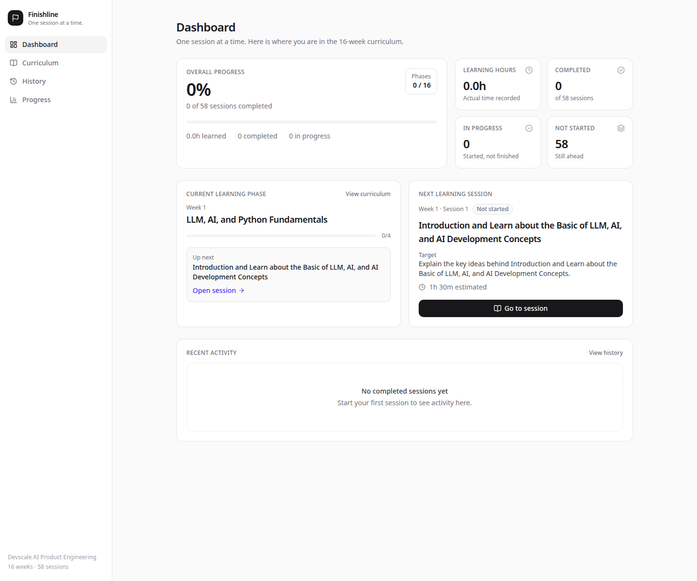

# Finishline

Personal tracker for the 16-week Devscale Indonesia **AI Product Engineering** curriculum.
One session at a time.



## Stack

| Layer | Tech |
| --- | --- |
| Frontend | React 19 + TypeScript + Vite + Tailwind CSS 4 + shadcn/ui (Radix) + Lucide + TanStack Query + React Router |
| Backend | Python 3.12 + FastAPI + SQLModel + Pydantic v2 |
| Database | SQLite (single local file, no server required) |
| Migration | Alembic |
| Tests | pytest + FastAPI TestClient |

## What works

- **Dashboard** — overall progress, current phase, next session, learning stats, recent activity.
- **Curriculum** — all 16 weeks / 58 sessions rebuilt from the original 22-topic lesson list
  (including every supplementary session).
- **Session detail** — objectives, topics, deliverable, status actions, learning notes, and a
  **Next material** button that jumps straight to the following session.
- **Learning material link + resume timestamp** — every regular session is seeded with its official
  YouTube recording (42 topics, in `app/seed/sources.py`). Save your last-watched position
  (`mm:ss`, `hh:mm:ss`, or seconds) and the **Open at …** button appends YouTube's `t=` param so the
  video resumes exactly there. Re-seeding never overwrites a link you saved.
- **NoteVault capstone** — the fifth session of every week is a milestone of one product built
  across the whole course: **NoteVault**, a self-hosted personal document assistant (local,
  cited, agentic). Each milestone brief has GOAL, BUILD steps, a DONE WHEN checklist, and a
  STRETCH goal, stored in `app/seed/notevault.py`.
- **Session lifecycle** — Start, Mark as Completed (asks for actual duration), Save Notes, Skip, Reset.
- **History** — filter by week, status, and date range, with note excerpts.
- **Progress** — overall percentage, learning hours, completed vs total, progress per week.
- All data persisted in a local SQLite database; nothing is a mockup.

## Project structure

```
.
├── backend/
│   ├── alembic/                # migration environment + initial schema
│   ├── app/
│   │   ├── api/routes/         # curriculum, sessions, insights routers
│   │   ├── services/           # progress rules, read models, status transitions
│   │   ├── seed/               # 16-week curriculum seed data
│   │   ├── config.py           # environment settings
│   │   ├── database.py         # engine + session dependency
│   │   ├── models.py           # SQLModel tables
│   │   ├── schemas.py          # Pydantic request/response models
│   │   └── main.py             # FastAPI app, CORS, startup seed
│   ├── tests/                  # progress calculation + status transition tests
│   └── requirements.txt
└── frontend/
    ├── src/
    │   ├── components/         # layout, app primitives, components/ui/ (shadcn)
    │   ├── hooks/queries.ts    # TanStack Query hooks (all server calls)
    │   ├── lib/                # API client, formatting, cn (shadcn utils)
    │   ├── pages/              # Dashboard, Curriculum, Session, History, Progress
    │   └── types.ts            # shared API types
    └── package.json
```

## Run locally

Prerequisites: Node.js 20+, Python 3.12 (or `uv`). No database server needed.

### 1. Backend

```bash
cd backend
uv venv --python 3.12          # or: python3.12 -m venv .venv
source .venv/bin/activate
uv pip install -r requirements.txt   # or: pip install -r requirements.txt
cp .env.example .env
alembic upgrade head
uvicorn app.main:app --reload --port 8000
```

`alembic upgrade head` creates `backend/finishline.db` if it does not exist. The curriculum is
seeded automatically on startup (idempotent — it only fills missing data).
Health check: <http://localhost:8000/api/health>

### 2. Frontend

```bash
cd frontend
npm install
npm run dev
```

Open <http://localhost:5173>. The dev server proxies `/api` to the backend, so the browser never
needs a hardcoded API port. If the backend runs on a non-default port, point the proxy at it:

```bash
VITE_API_PROXY_TARGET=http://127.0.0.1:8081 npm run dev
```

## Shortcuts

A [Makefile](Makefile) wraps the common commands:

```bash
make help                        # list all commands
make setup                       # first-time: deps + .env + database
make dev                         # run backend and frontend together
make backend                     # backend only (auto-migrates)
make frontend                    # frontend only
make migrate                     # apply pending migrations
make migration m="add table"     # autogenerate a migration
make downgrade                   # roll back the last migration
make reset-db                    # delete SQLite DB + migrate fresh (loses data)
make test                        # backend tests
make build                       # type-check + build frontend
make check                       # tests + build
make clean                       # remove build/test artifacts
```

`make dev` auto-selects the next free port when 8000/5173 are busy and prints the URLs it uses.
Force your own with `make dev BACKEND_PORT=8081 FRONTEND_PORT=5180`.

## Configuration

| Variable | Default | Purpose |
| --- | --- | --- |
| `DATABASE_URL` | `sqlite:///./finishline.db` | SQLAlchemy connection string (relative to `backend/`) |
| `TIMEZONE` | `Asia/Jakarta` | Timezone used to interpret history date filters |
| `CORS_ORIGINS` | `http://localhost:5173,http://127.0.0.1:5173` | Extra allowed origins (any localhost port is already allowed) |
| `VITE_API_URL` (frontend) | `/api` | Direct API base URL; leave unset in development |
| `VITE_API_PROXY_TARGET` (frontend) | `http://127.0.0.1:8000` | Vite dev proxy target; `make dev` sets it automatically |

## Tests

```bash
cd backend
source .venv/bin/activate
pytest -q
```

Covers progress calculation, phase/curriculum status rules, all status transitions, note saving,
history filtering, duration validation, and the one-progress-row-per-session constraint.

## API

All routes are under `/api`.

| Method | Path | Purpose |
| --- | --- | --- |
| GET | `/dashboard` | Aggregated dashboard data |
| GET | `/phases` | All phases with sessions and derived progress |
| GET | `/phases/{id}` | One phase |
| GET | `/sessions/{id}` | Session detail |
| POST | `/sessions/{id}/start` | Status → in progress, records `started_at` |
| POST | `/sessions/{id}/complete` | Status → completed, requires `actual_duration_minutes` (1–1440), saves notes |
| PATCH | `/sessions/{id}/notes` | Save notes without touching status |
| PATCH | `/sessions/{id}/source` | Save (or clear) the session's learning material URL |
| PATCH | `/sessions/{id}/timestamp` | Save (or clear) the last-watched video position in seconds |
| POST | `/sessions/{id}/skip` | Status → skipped (never counted as completed) |
| POST | `/sessions/{id}/reset` | Status → not started, clears timestamps/duration, keeps notes |
| GET | `/history` | `?week=&status=&date_from=&date_to=` |
| GET | `/progress` | Overall + per-week progress |
| GET | `/health` | Health check |

## Progress rules

- Overall and phase progress count **completed sessions only**.
- `skipped` is not completed; it only removes the session from the "next session" queue.
- Current session = first session, in curriculum order, that is neither completed nor skipped.
- Total learning hours = sum of actual minutes of completed sessions / 60.
- Phase status is derived: completed only when every session in the phase is completed.

## Technical decisions

- **SQLite file database** (`backend/finishline.db`) keeps the local, single-user app zero-setup.
  `check_same_thread=False` lets FastAPI's threadpool share connections.
- **Auto ports + dev proxy** — `make dev` picks free ports and points Vite's proxy at the chosen
  backend port. The browser only calls same-origin `/api`, so a busy 8000/5173 never breaks the UI.
- **WSL-friendly binding** — both dev servers bind `0.0.0.0`, because a server bound only to
  `127.0.0.1` inside WSL is unreachable from a Windows browser. Open `http://localhost:<port>`.
- **One progress row per session** enforced by a unique constraint on `session_progress.session_id`.
  Progress rows are created during seeding, so read models never need to invent state.
- **Timestamps stored as UTC** and returned as timezone-aware ISO strings via a small `UTCDateTime`
  type (SQLite has no native timezone type). The frontend renders them in local browser time;
  history date filters use the server `TIMEZONE` setting so "today" matches the user's day.
- **Alembic batch mode** is enabled so future schema changes still work on SQLite.
- **No chart library** — progress bars are plain CSS. Fewer dependencies, enough to read progress.
- **shadcn/ui on Radix** — `src/components/ui/` holds Button, Card, Badge, Dialog, AlertDialog,
  Input, Textarea, and Label. Native `window.confirm`/`alert` is replaced by an accessible
  AlertDialog. Tailwind CSS 4 tokens are defined in `src/index.css`; `components.json` is ready for
  the shadcn CLI.
- **Business logic lives in `app/services`**, not React components; the frontend only formats and
  renders API data.
- **No authentication**, per the first-version scope. Single local user.
- Seed learning objectives/topics are starter templates; per-session descriptions live in
  `app/seed/data.py`.

## Not included (intentionally)

- Authentication, social features, gamification, AI chatbot, course marketplace.
- Editing curriculum content from the UI.
- Redis/Celery or any background infrastructure.

## Reset to a fresh curriculum

Stop the backend, then:

```bash
cd backend
rm -f finishline.db
alembic upgrade head
uvicorn app.main:app --reload --port 8000   # seeds 16 weeks / 58 sessions on startup
```
